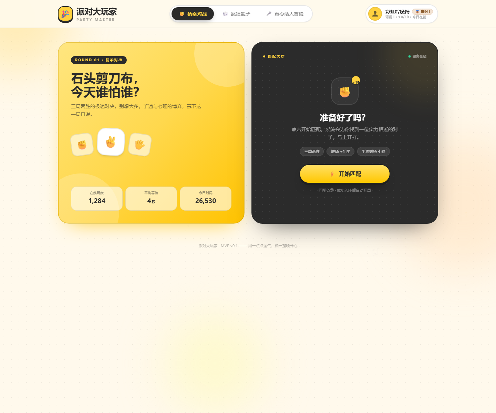
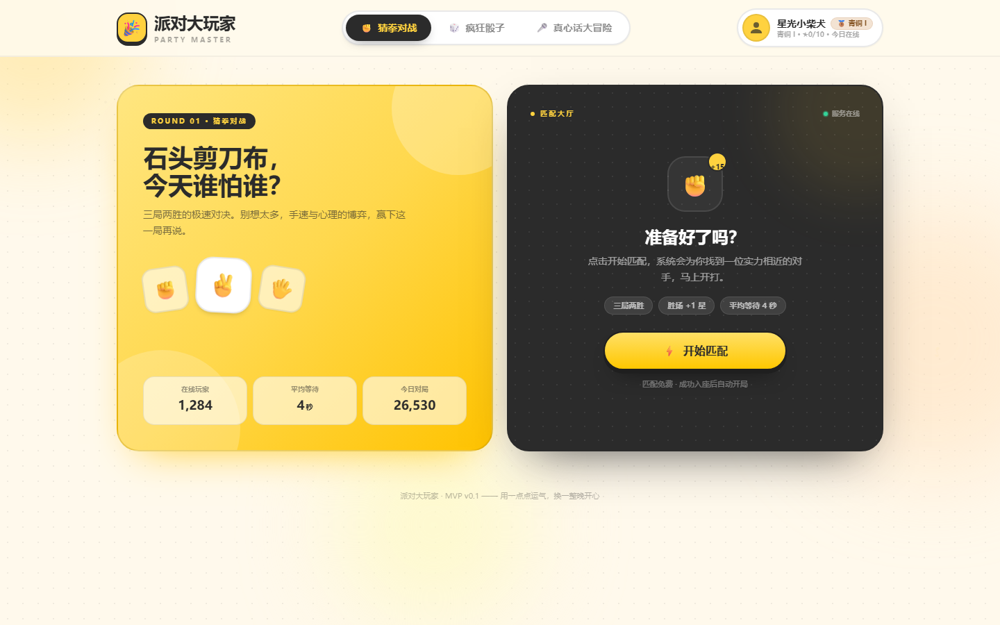
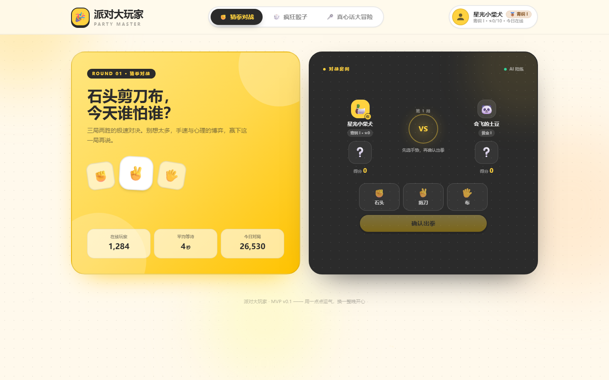
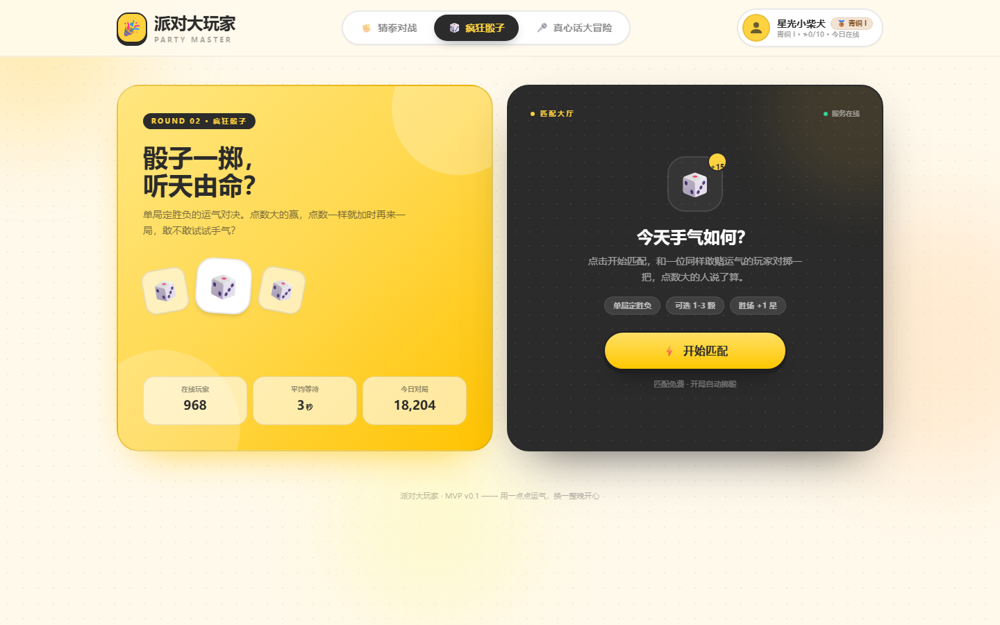
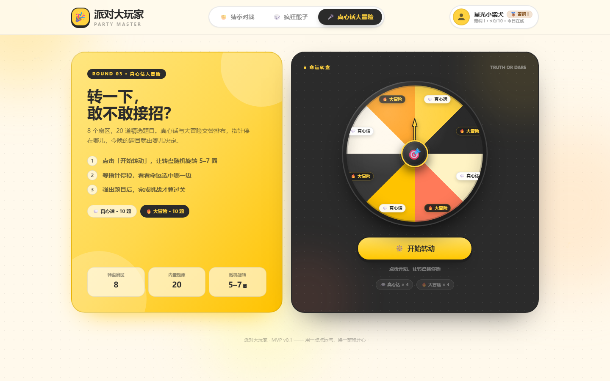
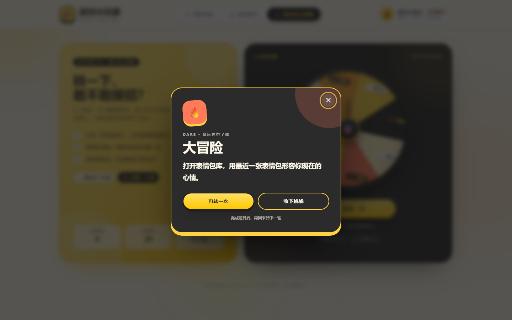

# 【LifeHack 生活娱乐】派对大玩家 Party Master：打开网页就能开局

## 一、作品链接

- 在线体验（Qoder Sites）：<https://party-master-ejzm6nqoes7.qoder.zone>
- 开源仓库（MIT）：<https://github.com/Yu-bit-g/party-master>
- GitHub Pages 镜像：<https://yu-bit-g.github.io/party-master/>

## 二、关于我

张舜禹，沧州交通学院，风景园林专业，1 人参赛。

天池账号：nick0277063806

## 三、一句话介绍

把线下聚会最常玩的猜拳、骰子、真心话大冒险做成一个打开网页就能玩的合集：能匹配真人实时对战，匹配不到就 3 秒接入 AI，一个人也能玩。

## 四、为什么做它

聚会开场最难的是"玩什么"：下载 App 麻烦，找道具麻烦，人少的时候更尴尬。

我想做一个零安装、零注册、打开就能开局的页面：朋友面对面可以各自打开网页对战，一个人也能和 AI 玩；输赢还能积累星星和段位，让每一次开局都有反馈。选择"派对"这个题目，是因为它天然适合用小而完整的交互承载快乐——一次出拳、一把骰子、一次转盘，几十秒就能完成一个情绪闭环。

## 五、怎么玩（5 步）

1. 打开链接，填写昵称、选择头像，进入游戏大厅。
2. 选择「猜拳对战」「疯狂骰子」或「真心话大冒险」。
3. 猜拳 / 骰子点击「开始匹配」，等待真人玩家；3 秒内无人则自动进入 AI 对战。
4. 猜拳双方同时选拳并确认，统一揭晓；骰子选择 1–3 颗后投掷，比较总点数。
5. 结算后获得星星并累积段位，数据保存在本地，下次打开继续。

真心话大冒险：点击转盘中央按钮，指针停在哪一格就抽哪一类题目。

## 六、功能亮点

- 三种玩法一个页面，桌面端与移动端自适应。
- PeerJS + WebRTC 点对点联机，对局数据不经过游戏服务器。
- 3 秒 AI 兜底，永远有人陪你玩。
- 本地成长系统：星星、段位、昵称头像持久化。
- 体验细节：VS 对战闪屏、3D 骰子滚动、出拳弹跳、转盘缓动、背景粒子。
- 隐私收敛：联机时只交换昵称、头像、段位，不上传完整本地战绩。

## 七、用 Qoder 的开发过程

1. **需求拆解**：先定"单页 + 零安装"的边界，把三个玩法拆成独立模块，共用匹配与结算逻辑。
2. **结构搭建**：用 Qoder 生成 Tailwind + 原生 JS 的单文件骨架，确定 Tab 导航、大厅、对战区、结算弹窗的层级。
3. **联机闭环**：接入 PeerJS，设计 `welcome / hello / pick / result` 消息协议，由主机统一结算，避免双方结果不一致。
4. **AI 兜底**：匹配 3 秒超时后切换到本地 AI，按约 40% 胜率控制难度，保证体验不中断。
5. **体验打磨**：补上 VS 特效、3D 骰子、出拳弹跳、转盘与粒子动画，并适配 `prefers-reduced-motion`。
6. **发布上线**：部署到 Qoder Sites 并设为公开访问，同时开源到 GitHub（MIT）。

开发过程截图：

## 八、技术与开源

- HTML5 + CSS3 + 原生 JavaScript，Tailwind CSS（Play CDN）
- PeerJS 1.5.4 / WebRTC 点对点连接
- LocalStorage 本地成长数据
- 代码以 MIT 协议开源，欢迎提 Issue 或 PR

## 九、已知限制与下一步

- 当前每个玩法使用固定房间号，同一玩法同一时间只支持一对玩家；下一步会改成随机房间码 / 房间列表。
- 计划增加「你画我猜」「谁是卧底」等更适合多人聚会的玩法。
